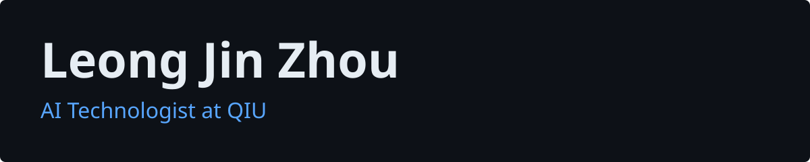
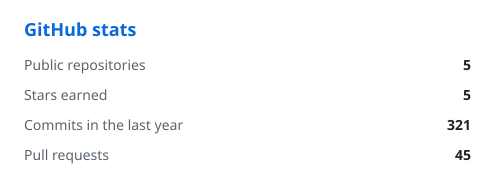
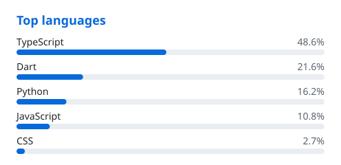

<!-- gen:banner -->

<!-- /gen:banner -->

# Hi, I'm Leong Jin Zhou

**AI Technologist at Quest International University (QIU), Malaysia.**
I build the systems a campus runs on: student portals, approval workflows, timetabling, career services, and AI tools for staff and students.

## What I work on

- **Campus systems** — student life, career placement and academic administration platforms for QIU.
- **Applied AI** — clinical analytics, document OCR, vision and LLM assistants built into real workflows.
- **AI-run engineering** — I ship software with a team of Claude Code agents under strict rules: security checks, multi-tenant design and three levels of tests on every task. Nothing ships without my sign-off on the spec, the plan and the merge.

## GitHub activity

<!-- gen:stats -->
<picture>
  <source media="(prefers-color-scheme: dark)" srcset="assets/stats-dark.svg">
  
</picture>
<!-- /gen:stats -->

<!-- gen:langs -->
<picture>
  <source media="(prefers-color-scheme: dark)" srcset="assets/langs-dark.svg">
  
</picture>
<!-- /gen:langs -->

<!-- gen:snake -->
<picture>
  <source media="(prefers-color-scheme: dark)" srcset="assets/snake-dark.svg">
  
</picture>
<!-- /gen:snake -->

## Featured projects

<!-- gen:featured -->
| Preview | Project | What it does | Stack |
|---|---|---|---|
|  | [QIU CPDC Career Portal](https://github.com/LeongJinZhou/qiu-cpdc-career-portal) · [live](https://qiu-cpdc.example.com/) | Multi-role career and industrial placement platform with AI learning and a gamified XP ledger | TypeScript, nextjs, prisma |
|  | [Pocket-G](https://github.com/LeongJinZhou/Pocket-G) | Secure mobile web client for a remote AI coding CLI over Tailscale | JavaScript, a |
|  | [Medical Report OCR](https://github.com/LeongJinZhou/OCR1) | Digitises medical reports from photos and PDFs | Dart, a |
<!-- /gen:featured -->

## Tools I use

<!-- gen:skills -->

<!-- /gen:skills -->

## Contact

<!-- gen:contact -->
- [GitHub](https://github.com/LeongJinZhou)
<!-- /gen:contact -->
